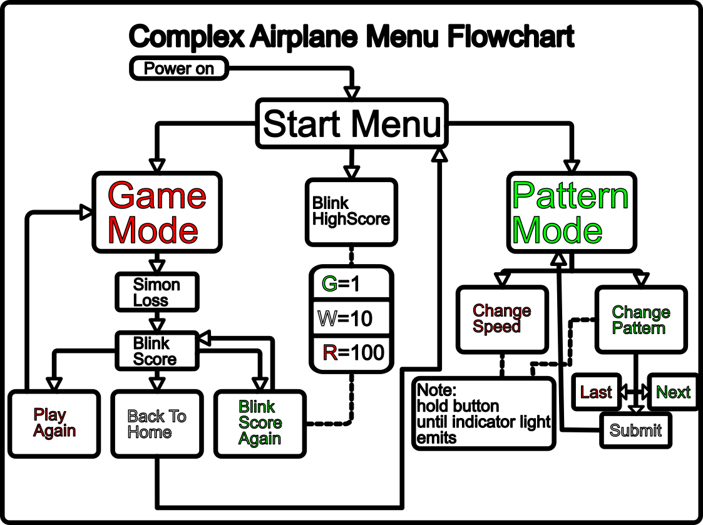

# UTC-2026-Mini-Bage

This year it was my responisbitly to make our student section Mini Badges. We decide to do two badges this year:
the (Complex Airplane) aswell as the [simple Airplane](#simple-airplane)

# Complex Airplane

## Kit Contents

Each kit should contain:

* 1x ATTiny85 (we used ATtiny85-20PU)
* 1x Green 3mm LED
* 1x White 3mm LED
* 2x Red   3mm LED
* 3x 2 pin SPST Buttons
* 1x 1P2T 2 Position switch (3 pins)
* 2x resistor 750 Ohms
* 1x resistor 350 Ohms
* 1x BAT-HLD-003-SMT
* 1x CR2032 coin battery
* 1x Pin and Back
* 1x Complex Airplane PCP

## Asemblely instructions

The key to doing this one right is taking it slow, 
you want to solder it one side at a time (back then front),
soldering the parts in reverse order of height:

Solder Order
    Back:
        1. resistors
        2. ATTiny Chip
        3. battery Back
        4. swich
        5. Pin (do this one BEFORE soldering front side)

    Front: (Side with Airplane)
        1. buttons
        2. LEDs

## Example Pictures

## Complex Airplane Software Explantion

Here is the offical unreleased Instruction booklet, The origaial plan was to print these and hand them out but that didnt end up happening. 
[Instruction Booklet](./complexAirplaneInstructions.pdf)

Here too is a flowchart version that may help clairify things in the future!

# Simple Airplane

## Kit Contents

Each kit should contain:

* 1x Green 3mm LED
* 1x White 3mm LED
* 2x Red   3mm LED
* 1x 1P2T 2 Position switch (3 pins)
* 1x BAT-HLD-003-SMT
* 1x CR2032 coin battery
* 1x Pin and Back
* Simple Airplane PCB

## Asemblely instructions

## example Pictures

# Would you like to remake one of these badges?

Perfect! all the stuff you need to recreate these kits are located in this repo!

## Complex
    
## Simple
